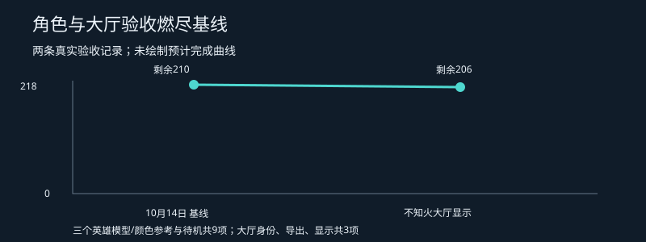

# 角色恢复进度与燃尽记录

统计范围：本 APK 中 35 条 UseRole=1 英雄配置。每位按六项验收：模型、贴图参考、待机、完整基础动作、大招演出、完整战斗接入。模型/贴图参考完成不等于原材质复原；部分接入不计完整完成。

| ID | 英雄 | 模型 | 贴图参考 | 待机 | 基础动作 | 大招演出 | 战斗接入 |
|---:|---|---|---|---|---|---|---|
| 1 | 艾尔莎 | 已验证 | 已验证 | 已验证 | 部分恢复 | 待恢复 | 单人试玩 |
| 2 | 琳 | 已验证 | 已验证 | 已验证 | 已提取未播放 | 已提取未播放 | 待接入 |
| 3 | 未来 | 待核验 | 立绘样本 | 待核验 | 待核验 | 待核验 | 待接入 |
| 4 | 瓦列莉亚 | 待核验 | 待核验 | 待核验 | 待核验 | 待核验 | 待核验 |
| 5 | 佐伊 | 待核验 | 待核验 | 待核验 | 待核验 | 待核验 | 待核验 |
| 6 | 诺 | 待核验 | 待核验 | 待核验 | 待核验 | 待核验 | 待核验 |
| 7 | 米多绿·未来 | 待核验 | 待核验 | 待核验 | 待核验 | 待核验 | 待核验 |
| 8 | 御座纱织 | 待核验 | 待核验 | 待核验 | 待核验 | 待核验 | 待核验 |
| 9 | 苏默亚 | 待核验 | 待核验 | 待核验 | 待核验 | 待核验 | 待核验 |
| 10 | 白鹭 | 待核验 | 待核验 | 待核验 | 待核验 | 待核验 | 待核验 |
| 11 | 阿尔提奥 | 待核验 | 待核验 | 待核验 | 待核验 | 待核验 | 待核验 |
| 12 | 黑鸟茉莉 | 待核验 | 待核验 | 待核验 | 待核验 | 待核验 | 待核验 |
| 13 | 古城遥 | 待核验 | 待核验 | 待核验 | 待核验 | 待核验 | 待核验 |
| 14 | 红桃子 | 待核验 | 待核验 | 待核验 | 待核验 | 待核验 | 待核验 |
| 15 | 梅塔特隆 | 待核验 | 待核验 | 待核验 | 待核验 | 待核验 | 待核验 |
| 16 | 伊莎贝拉 | 待核验 | 待核验 | 待核验 | 待核验 | 待核验 | 待核验 |
| 17 | 艾娜 | 待核验 | 待核验 | 待核验 | 待核验 | 待核验 | 待核验 |
| 18 | 律子 | 待核验 | 待核验 | 待核验 | 待核验 | 待核验 | 待核验 |
| 19 | 赤姬 | 待核验 | 待核验 | 待核验 | 待核验 | 待核验 | 待核验 |
| 21 | 希娅 | 待核验 | 待核验 | 待核验 | 待核验 | 待核验 | 待核验 |
| 22 | 贝鲁卡 | 待核验 | 待核验 | 待核验 | 待核验 | 待核验 | 待核验 |
| 23 | 苔丝 | 待核验 | 待核验 | 待核验 | 待核验 | 待核验 | 待核验 |
| 24 | 萝丝 | 待核验 | 待核验 | 待核验 | 待核验 | 待核验 | 待核验 |
| 25 | 黑 | 待核验 | 待核验 | 待核验 | 待核验 | 待核验 | 待核验 |
| 26 | 芙里斯 | 待核验 | 待核验 | 待核验 | 待核验 | 待核验 | 待核验 |
| 27 | 伊芙 | 待核验 | 待核验 | 待核验 | 待核验 | 待核验 | 待核验 |
| 28 | 笠 | 待核验 | 待核验 | 待核验 | 待核验 | 待核验 | 待核验 |
| 29 | 薇薇安 | 待核验 | 待核验 | 待核验 | 待核验 | 待核验 | 待核验 |
| 30 | 沢 | 待核验 | 待核验 | 待核验 | 待核验 | 待核验 | 待核验 |
| 31 | 妖刀姬 | 待核验 | 待核验 | 待核验 | 待核验 | 待核验 | 待核验 |
| 32 | 青行灯 | 待核验 | 待核验 | 待核验 | 待核验 | 待核验 | 待核验 |
| 33 | 不知火 | 已验证 | 已验证 | 已验证 | 待核验 | 待恢复 | 大厅展示 |
| 34 | 以津真天 | 待核验 | 待核验 | 待核验 | 待核验 | 待核验 | 待核验 |
| 35 | 彼岸花 | 待核验 | 待核验 | 待核验 | 待核验 | 待核验 | 待核验 |
| 36 | 铃鹿御前 | 待核验 | 待核验 | 待核验 | 待核验 | 待核验 | 待核验 |

已验证依据：艾尔莎见 docs/elsa-model-conversion.md、docs/battle-idle.md、docs/battle-visual-recovery.md；琳见 docs/lynn-recovery.md。其他英雄本轮仅完整读取角色配置，尚未逐角色做模型/动作验收，不将“待核验”解释为资源缺失。

## 大厅优先验收清单

- [x] 原场景身份：场景表203，HallSceneHome，midgard_home_3d。
- [x] 环境模型与颜色贴图导出：79份网格、116实例、61纹理。
- [x] 浏览器实际显示与原镜头参数载入（原渲染器方向一致性仍待验证）。
- [ ] 原大厅UI图集、按钮和布局。
- [ ] 大厅角色及互动动作。
- [ ] 原材质、灯光、反射和特效。
- [ ] 共享Cocos大厅接入与存档入口。
- [ ] 最新四平台构建和大厅实机游玩。

## 燃尽基线

当前登记218项验收（35×6角色项＋8大厅项），完整通过12项，剩余206项。每项权重相同，仅用于跟踪验收数量；不是工时、开发完成百分比，也不包含整个项目所有需求。
2026-10-14是首次建立此口径的真实记录。没有补造过去曲线，没有估算截止日期；后续通过验收时追加记录，范围变化单独登记。

| 记录日期 | 总项 | 完整通过 | 剩余 |
|---|---:|---:|---:|
| 2026-10-14 基线 | 218 | 8 | 210 |
| 2026-10-14 不知火大厅显示 | 218 | 12 | 206 |

原生包仍需更新；macOS/iOS实际构建运行尚未通过。大招骨骼动作、镜头、特效、音效和战斗触发须分别验收。
